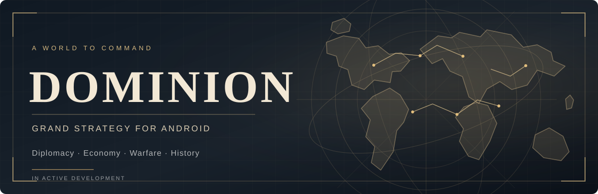

### Создаю Dominion — глобальную стратегию, в которой решения меняют судьбу государств.

Карта мира. Политика. Экономика. Дипломатия. Война.

 

[**Репозиторий игры**](https://github.com/elcin31/grand-strategy-multiplayer) · [**Android-сборки**](https://github.com/elcin31/grand-strategy-multiplayer/releases) · [**Ход разработки**](https://github.com/elcin31/grand-strategy-multiplayer/blob/main/DEVELOPMENT_HANDOFF.md)

 

---

## DOMINION

**Dominion** — самостоятельная мобильная grand strategy, которую я разрабатываю для Android. Игрок управляет государством на мировой карте: принимает политические решения, развивает экономику, строит армии, ведёт переговоры и определяет направление развития страны.

Цель — создать не набор разрозненных кнопок, а **связанную стратегическую систему**, в которой экономика влияет на военную мощь, дипломатия меняет баланс сил, а внутренняя политика имеет последствия.

## Мир и игровые механики

| Направление | Что есть в проекте |
| :-- | :-- |
| **Глобальная карта** | Игровые государства, провинции, города и режимы отображения карты |
| **Государственное управление** | Правительства, население, стабильность и внутренняя политика |
| **Экономика** | Ресурсы, здания, развитие территорий, государственные финансы и долги |
| **Армия и войны** | Формирование войск, перемещения, боевые действия и управление территориями |
| **Дипломатия** | Отношения между государствами, переговоры, войны и мирные соглашения |
| **Технологии** | Исследования и развитие возможностей государства |
| **Искусственный интеллект** | Стратегические действия государств под управлением AI |
| **Кампании** | Одиночная игра, сохранения и серверный мультиплеер |

Это обзор существующих направлений игры, а не утверждение, что каждая механика уже полностью готова или сбалансирована.

## Dominion 2.0 · В разработке

Сейчас работаю над крупным обновлением, которое должно сделать игру глубже, удобнее и стабильнее:

- **Глубина стратегии:** развитие экономики, армии, дипломатии и технологий.
- **Национальные фокусы:** отдельное направление расширения стратегических решений.
- **Android performance:** снижение лагов при перемещении камеры, масштабировании и навигации по карте.
- **Управление:** более предсказуемый выбор армий, перемещение войск и взаимодействие с провинциями.
- **Визуальный стиль:** историческая атмосфера, иллюстрации и удобный landscape-интерфейс.
- **Надёжность:** сохранения, мультиплеер, тестирование и совместимость с реальными Android-устройствами.

**Статус:** Dominion 2.0 находится в активной разработке. Последняя отдельно задокументированная Android-сборка в репозитории — [0.8.1 camera & illustrations](https://github.com/elcin31/grand-strategy-multiplayer/releases/tag/v0.8.1-camera-illustrated). Это тестовый checkpoint, не финальный релиз 2.0.

## Технологии

- Нативная отрисовка карты с использованием **Skia**.
- Логика симуляции и интерфейс на **TypeScript / React Native**.
- Отдельная серверная инфраструктура для авторитетного мультиплеера.
- Автоматизированные проверки, Android-сборки и тестирование производительности.

## Принципы разработки

**Стратегическая глубина без хаоса.** Сложные механики должны быть логичными и понятными игроку.

**Мобильная игра, а не уменьшенная ПК-версия.** Интерфейс и управление разрабатываются с учётом Android-устройств.

**Производительность важнее красивых цифр.** Заявления о плавности игры требуют проверки на реальном железе, а не только в эмуляторе.

---

  <strong>ONE WORLD. MANY EMPIRES. YOUR DECISIONS.</strong>
    
  <a href="https://github.com/elcin31/grand-strategy-multiplayer"><strong>DOMINION · SOURCE & DEVELOPMENT</strong></a>
  &nbsp;·&nbsp;
  <a href="https://github.com/elcin31/grand-strategy-multiplayer/issues">Issues / Feedback</a>

