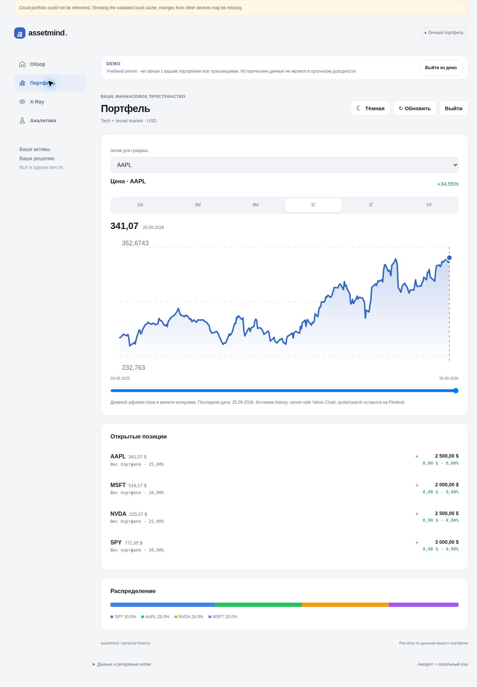

  <h1>elcin31</h1>
  
<strong>Finance software · Grand strategy games · Systems engineering</strong>

  
Разрабатываю собственные продукты на пересечении финансов, аналитики и игровых систем.

  

    <a href="https://github.com/elcin31/assetmind-v031"><strong>AssetMind</strong></a>
    &nbsp;·&nbsp;
    <a href="https://github.com/elcin31/grand-strategy-multiplayer"><strong>Dominion</strong></a>
  

---

## Обо мне

Мне интересны проекты, где важны **логика, данные и сложные взаимосвязанные системы**: от расчёта риска инвестиционного портфеля до симуляции государств, экономики и дипломатии.

Сейчас развиваю два основных проекта. Оба находятся в активной разработке.

## Проекты

### [AssetMind](https://github.com/elcin31/assetmind-v031) · Portfolio Analytics

Инструмент для учёта инвестиционного портфеля и исследования его доходности, риска и структуры.

- **Портфель:** сделки, денежные потоки, позиции, P&L и синхронизация данных.
- **Аналитика:** историческая доходность, просадки, Sharpe, Sortino, VaR и Expected Shortfall.
- **Исследования:** корреляции, вклад активов в риск, бенчмарки, атрибуция и стресс-сценарии.
- **Подход:** расчёты должны быть проверяемыми; если данных недостаточно, метрика не выдумывается.

**Стек:** React · TypeScript · Vite · Supabase · Vercel

[Открыть приложение](https://assetmind-v031-mpsk.vercel.app) · [Исходный код](https://github.com/elcin31/assetmind-v031)

  
  
Демо-интерфейс AssetMind. Позиции на скриншоте синтетические.

### [Dominion](https://github.com/elcin31/grand-strategy-multiplayer) · Grand Strategy

Мобильная глобальная стратегия для Android с картой мира, государствами, провинциями и взаимосвязанными игровыми механиками.

- **Управление государством:** экономика, население, технологии, строительство и политика.
- **Стратегия:** армии, войны, дипломатия и поведение игровых государств под управлением AI.
- **Кампании:** одиночная игра, сохранения и серверный мультиплеер.
- **Разработка:** оптимизация карты, мобильного интерфейса и игрового цикла для Android.

**Стек:** React Native · Expo · TypeScript · Skia · отдельный игровой backend

**Статус:** активная разработка и тестирование Android-сборок. Dominion 2.0 не обозначается как завершённый релиз.

[Репозиторий и техническая документация](https://github.com/elcin31/grand-strategy-multiplayer)

---

## Что для меня важно

| В аналитике | В разработке игр |
| --- | --- |
| Корректность расчётов и качество данных | Последовательные правила симуляции |
| Явные ограничения моделей | Предсказуемое поведение механик |
| Понятный интерфейс сложных метрик | Производительность на реальных устройствах |

  Building real products, one iteration at a time.

